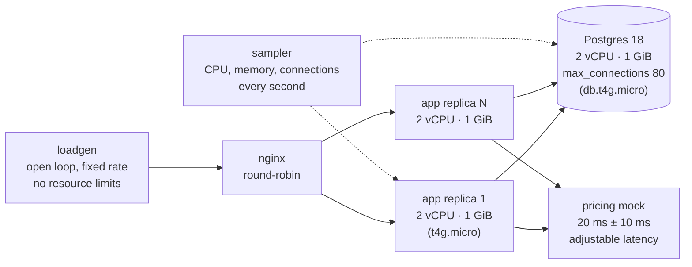

# Benchmarks: Go, Java and Python at AWS instance sizes

**English** | [Português](BENCHMARKS.pt-BR.md)

Same service, same specification, same contract tests, same CPU and memory limits as AWS t4g instances. What changes is the language and, for Go, whether the agent that wrote the code had go-skills loaded.

Measured in October 2026 on Docker Desktop, with container limits that reproduce AWS instance sizes. No AWS resources were created; costs use AWS public on-demand prices for that month. **Every scenario ran 3 times**; numbers are the median, with the min–max range in parentheses where it matters.

## Summary

| | Go with go-skills | Go without go-skills | Java 25 + Spring Boot | Python 3.13 + FastAPI |
|---|---|---|---|---|
| Capacity per replica (2 vCPU, 1 GiB) within SLO | **5,000 req/s** (3 of 3) | 5,000 req/s (3 of 3) | 3,000 req/s (4,000 in 1 of 3), warm JVM | 1,200 req/s (3 of 3) |
| CPU per request at 1,200 req/s | **0.35 ms** | 0.36 ms | 0.52 ms | 0.92 ms |
| Memory under normal load | **15 MiB** | 16 MiB | 275 MiB | 206 MiB |
| Peak memory (worst scenario) | **35 MiB** | 572 MiB | 928 MiB of 1,024 | 211 MiB |
| Above capacity | **sheds with 503, p99 ~130 ms, stays up** | p99 1.7 s, then 66% errors | 90%+ errors | 16–58% errors |
| Cold start straight into 3,000 req/s | **0% errors** | 0% errors | 92% errors | — |
| US$/month for 5,000 req/s (us-east-1) | **45** | — | 68 | 137 |
| US$/month for 20,000 req/s (us-east-1) | **180** | — | 270 | 547 |

SLO: p99 below 200 ms and fewer than 1% errors.

### Tuned Go: twice the capacity

A fourth Go version, [go-tuned](benchmarks/orders-api/impl/go-tuned/), starts from the go-skills version and applies two changes guided by a CPU profile, under the same fairness rules (same contract, at most 8 connections per replica, no caching of prices or reads). [TUNING.md](benchmarks/orders-api/impl/go-tuned/TUNING.md) lists every change and its measured effect.

1. **One database round trip per read.** An order and its items come from the same query (`LEFT JOIN LATERAL` with `array_agg`) instead of one query for orders and another for items.
2. **A sized pricing client with a circuit breaker.** The cap on concurrent pricing calls was 64 with a 100 ms wait, and that guessed number was the only cause of the 503s at 6,000 req/s. It is now 256, sized by Little's law, with no wait; every call has a 1 s budget; and a circuit breaker opens after 5 consecutive failures.

Verified separately, 3 runs:

| | Go with go-skills | **Tuned Go** |
|---|---|---|
| Capacity within SLO | 5,000 · 5,000 · 5,000 | **10,000 · 8,000 · 10,000** |
| 6,000 req/s | 1.3% errors, p99 130 ms | **0%, p99 32 ms** |
| 8,000 req/s | 4.8% errors, p99 132 ms | **0%, p99 32 ms** |
| 10,000 req/s | 17% errors, p99 143 ms | **0.65% errors, p99 47 ms** |
| 12,000 / 14,000 req/s | — | 18% / 39% fast 503s, p99 ~60 ms |
| CPU per request at 3,000 req/s | 0.305 ms | **0.277 ms** (−9%) |
| p99 with pricing at 1.5 s | 1,594 ms | **3 ms** |
| Peak memory | 35 MiB | 54 MiB |

One caveat: in the 8-replica scenario (S2), one of 5 tuned runs hit a database slowdown that filled the pools (65 connections) and produced 0.5% errors; the other 4 were clean, and the go-skills version was clean in all 5. The logs show the database slowing down for every operation at once, not the service; it is recorded here because it happened.

### The skills learn: v1 → v2 → v3

The tuned version's lessons became rules in the skills, and the same agent generated the service again from the same specification, with no manual changes afterwards:

| | v1 (go-skills 0.3) | Hand-tuned | v2 (go-skills 0.4.0) | **v3 (go-skills 0.4.1)** |
|---|---|---|---|---|
| Capacity within SLO, 3 runs | 5,000 · 5,000 · 5,000 | 10,000 · 8,000 · 10,000 | 4,000 · 4,000 · 4,000 | **10,000 · 10,000 · 10,000** |
| 10,000 req/s | 17% errors | 0.65% | 16% | **0.09%** |
| 12,000 req/s | — | 17.7% | 33% | **5.4%** |
| 14,000 req/s | — | 38.9% | 46% | **25.7%** |
| CPU per request at 3,000 req/s | 0.305 ms | 0.277 ms | 0.260 ms | **0.257 ms** |
| p99 with pricing at 1.5 s | 1,594 ms | 3 ms | 2 ms | **2 ms** |
| 8 replicas (S2) | clean | 1 run with 0.5% in 5 | clean | **clean**, 21 of 80 connections |

- **v2** took the `LEFT JOIN LATERAL` query, the circuit breaker and the no-wait bulkhead from the skills, and got the lowest CPU per request. But it sized the pricing bulkhead at 64 from an assumed 1,000 calls/s per replica, a quarter of what the replica actually admits. Every one of its errors (25,000 in one run) was "bulkhead full", with idle CPU and p99 at 32 ms.
- The `overload-protection` rule was corrected to **size from the peak the replica admits** (capacity × calls per request × latency), not from an assumed average.
- **v3**, generated with the corrected rule, sized the bulkhead at 256 and beat the hand-tuned version on every row of the table.

With v3, EC2 comes to **2 × t4g.micro (US$ 38/month) for 5,000 req/s** and **3 × t4g.micro (US$ 151/month, SP: US$ 162) for 20,000 req/s**, against US$ 270 for Java and US$ 547 for Python at the same load.

#### What 10,000 req/s costs for a whole month

The t4g.micro list price (US$ 6.13/month in the US, US$ 9.78 in São Paulo) only applies to a nearly idle instance, below its 10% CPU baseline. Serving 10,000 req/s nonstop, v3 uses 1.77 cores (1.75–1.86 across 3 runs) and AWS bills the unlimited-mode CPU surplus:

| | US (us-east-1) | Brazil (sa-east-1, São Paulo) |
|---|---|---|
| 1 × t4g.micro at 10,000 req/s, measured (no redundancy) | US$ 52/month | US$ 56/month |
| **Go v3: 2 × t4g.micro** (redundancy and 30% headroom) | **US$ 76/month** | **US$ 83/month** |
| Java: 5 × t4g.small | US$ 135/month | US$ 172/month |
| Python: 12 × t4g.micro | US$ 273/month | US$ 317/month |

10,000 req/s for a month is 26 billion requests, about US$ 0.002 per million. Application tier only; RDS is the same for all.

**Plain reading:** a warm JVM delivers 60% of Go's capacity per replica with 18 times the memory, needs to warm up before it can take load, and collapses past its limit. Python costs 2.6 times more CPU per request. Go's biggest difference is not in the averages but under pressure: flat memory, no warm-up, and controlled degradation when load exceeds capacity.

---

## Test map



| Scenario | Load | What it measures |
|---|---|---|
| **S1 capacity** | ramp 200 → 3,000 req/s, 20 s per step, 1 replica | highest rate within SLO, CPU per request |
| **S2 fleet** | 2,000 req/s for 60 s, 8 replicas | whether the pools fit the database's 80 connections |
| **S3 spike** | 800 → 4,000 → 800 req/s | whether the service survives a spike and recovers |
| **S4 slow dependency** | 400 req/s with the pricing service at 1.5 s | whether the rest of the API keeps answering |
| **S5 cold limit** | ramp 3,000 → 10,000 req/s, no warm-up | where each implementation breaks and how |
| **S7 warm Java** | ramp 500 → 8,000 req/s, 90 s of warm-up | a fair JVM capacity after JIT |

Every scenario ran 3 times, always on a freshly created and seeded database (200,000 orders, 600,000 items, one customer with 40,000 orders) and with the contract tests before the load. An implementation that fails the contract is not measured; all four passed in all 60 runs.

### Workload

| Operation | Share | What it exercises |
|---|---|---|
| `GET /orders/{id}` | 45% | keyed read with items |
| `GET /customers/{id}/orders` | 25% | pagination with items (N+1 and OFFSET traps); 10% on the customer with 40k orders |
| `POST /orders` | 15% | transaction with 3 items |
| `GET /orders/{id}/quote` | 15% | fan-out to the pricing service, one GET per item |

The generator schedules each request on a fixed clock and measures latency from the scheduled time, so a server that stalls pays for the queue it creates; requests over 2 s count as errors.

---

## Models

### The four implementations

All four were generated by a coding agent from the same [specification](benchmarks/orders-api/SPEC.md), without manual edits, and passed the same [contract tests](benchmarks/orders-api/harness/contract/contract_test.go).

| Implementation | Stack | Choices the code made |
|---|---|---|
| [Go with go-skills](benchmarks/orders-api/impl/go-with/) | Go 1.26, `net/http`, pgx v5 `pgxpool` | pool = 80 connections ÷ 10 replicas, 250 ms wait for the pool then 503, keyset pagination, `= ANY` for items |
| [Go without go-skills](benchmarks/orders-api/impl/go-without/) | Go 1.26, `net/http`, pgx v5 `pgxpool` | pool of 8, 3 s timeout per query, keyset pagination, `= ANY` for items |
| [Java](benchmarks/orders-api/impl/java/) | Java 25, Spring Boot 3, Spring MVC with virtual threads, JDBC + HikariCP | `-XX:MaxRAMPercentage=70`, `ExitOnOutOfMemoryError` |
| [Python](benchmarks/orders-api/impl/python/) | Python 3.13, FastAPI, uvicorn (2 workers, uvloop), asyncpg | one pool per worker |

The Java and Python versions came with their own Dockerfile, used as delivered. Both Go versions use the same [Dockerfile](benchmarks/orders-api/harness/go.Dockerfile) (static build, distroless).

### Reproduced instances

| Role | Container limit | AWS equivalent |
|---|---|---|
| Application | 2 vCPU, 1 GiB | EC2 t4g.micro |
| Database | 2 vCPU, 1 GiB, `max_connections=80`, `shared_buffers=256MB` | RDS db.t4g.micro |
| Load balancer, generator, mock | no limit | not costed |

### Cost model

- AWS on-demand Linux prices, October 2026, from the public price files.
- T4g runs in **unlimited** mode by default: hourly price plus US$ 0.04 per vCPU-hour of average CPU above baseline (t4g.micro 10% × 2 vCPU = 0.2 core; small and medium 20% × 2 = 0.4).
- Each instance is planned at 70% of the median capacity (30% headroom), and every fleet has at least 2 instances.
- 730 hours per month. The database is excluded because the queries are the same for every implementation.

| Instance | vCPU | Memory | us-east-1 (US$/h) | sa-east-1 (US$/h) |
|---|---|---|---|---|
| t4g.micro | 2 | 1 GiB | 0.0084 | 0.0134 |
| t4g.small | 2 | 2 GiB | 0.0168 | 0.0268 |
| t4g.medium | 2 | 4 GiB | 0.0336 | 0.0536 |
| db.t4g.micro (RDS PostgreSQL) | 2 | 1 GiB | 0.016 | 0.034 |

---

## Results

### Capacity and efficiency (S1, S5, S7)

| | Capacity in each run | p99 at capacity | CPU per request at 1,200 req/s | CPU per request at 3,000 req/s | Memory |
|---|---|---|---|---|---|
| Go with go-skills | 5,000 · 5,000 · 5,000 | 43 ms (39–43) | 0.352 ms (0.301–0.370) | 0.305 ms (0.244–0.319) | 15 MiB |
| Go without go-skills | 5,000 · 5,000 · 5,000 | 41 ms (40–45) | 0.355 ms (0.352–0.373) | 0.314 ms (0.311–0.405) | 16 MiB |
| Java (warm) | 4,000 · 3,000 · 3,000 | 33 ms at 3,000 | 0.520 ms (0.515–0.563) | 0.453 ms (0.433–0.474) | 275 MiB (233–284) |
| Python | 1,200 · 1,200 · 1,200 | 77 ms (77–87) | 0.924 ms (0.907–1.069) | — | 206 MiB |

The ~32 ms p99 under normal load is the quote operation, which waits on the pricing service's 20 ms.

### Above capacity (S5, S7)

Error rate, median of 3 runs:

| Rate | Go with go-skills | Go without go-skills | Java (warm) | Python |
|---|---|---|---|---|
| 1,600 req/s | 0% | 0% | 0% | 15.9% |
| 4,000 req/s | 0% | 0% | 0% in 2 runs, 70% in 1 | — |
| 5,000 req/s | 0%, p99 43 ms | 0%, p99 41 ms | **90%**, p99 12 s | — |
| 6,000 req/s | 1.3% (fast 503), p99 130 ms | 0%, but **p99 1.7 s** | 90% | — |
| 8,000 req/s | 4.8% (fast 503), p99 132 ms | **65.6%**, p99 16 s | 97% | — |
| 10,000 req/s | 17% (fast 503), p99 143 ms | 99.6% | — | — |
| Memory at the worst moment | **35 MiB** | 572 MiB (550–593) | 922 MiB (916–929) | 211 MiB |

Go with go-skills waits at most 250 ms for a database connection and answers 503 when the pool is exhausted, as the `postgres-pgx-pool` skill prescribes. That keeps latency under 150 ms even at twice its capacity: it sheds the excess instead of queueing it. The version without the skill waits up to 3 s per connection, the queue grows, memory reaches 572 MiB and the service collapses. The result repeated in all 3 runs.

### Spike and recovery (S3: 800 → 4,000 → 800 req/s)

| | Errors during the spike | Errors after the spike | Memory |
|---|---|---|---|
| Go with go-skills | 0% | 0% | 25 MiB |
| Go without go-skills | 0% | 0% | 20 MiB |
| Java | 94% (91–94), p99 27 s | **37%** (18–66), did not recover | 908 MiB |
| Python | 94% (94–95), p99 28 s | **27%** (5–33) | 211 MiB |

In this scenario Java had 20 s of warm-up at 800 req/s before the spike. In production, that is what happens when autoscaling adds a fresh instance in the middle of a spike.

### Cold start (S5: straight into 3,000 req/s, no ramp)

| | Errors in the first 20 s |
|---|---|
| Go with go-skills | 0% |
| Go without go-skills | 0% |
| Java | **92%** (90–93), and did not recover in later steps |

### Fleet of 8 replicas (S2: 2,000 req/s)

| | Peak Postgres connections | p99 | Fleet CPU |
|---|---|---|---|
| Go with go-skills | **20 / 80** (18–21) | 32 ms | 0.93 core |
| Go without go-skills | 26 / 80 (23–30) | 32 ms | 0.93 core |
| Java | 65 / 80 | 61 ms (47–66) | 4.27 cores |
| Python | 65 / 80 | 223 ms (219–269) | 3.65 cores |

At 250 req/s per replica, Java and Python spend about 4 times Go's CPU, because each process's fixed cost (JIT, GC, workers) repeats in every replica. Java and Python also reached 65 of 80 connections: two more replicas during a deploy would exceed the limit.

### Slow dependency (S4: pricing service at 1.5 s)

The ~15% expected errors are the quotes, which should fail with 503 when pricing is slow. What differs is how they fail:

| | How quotes fail | p99 | Memory |
|---|---|---|---|
| Go with go-skills | 503 at 1.6 s | 1,594 ms | 15 MiB |
| Go without go-skills | stuck until the client gives up (2 s) | 2,002 ms | 22 MiB |
| Java | mostly stuck until 2 s, some 503 | 2,002 ms | 421 MiB |
| Python | 503 at 1 s | 1,009 ms | 128 MiB |

Other operations stayed fast in every implementation (p50 under 2 ms).

---

## EC2: how many instances and what it costs

Best instance for each language, respecting memory (Java's 928 MiB peak does not fit safely in 1 GiB):

| Load | Go with go-skills | Java 25 + Spring Boot | Python 3.13 + FastAPI |
|---|---|---|---|
| **1,000 req/s** | 2 × t4g.micro · **US$ 12** (SP: US$ 20) | 2 × t4g.small · US$ 25 (SP: US$ 39) | 2 × t4g.micro · US$ 28 (SP: US$ 35) |
| **5,000 req/s** | 2 × t4g.micro · **US$ 45** (SP: US$ 52) | 3 × t4g.small · US$ 68 (SP: US$ 90) | 6 × t4g.micro · US$ 137 (SP: US$ 159) |
| **20,000 req/s** | 6 × t4g.micro · **US$ 180** (SP: US$ 202) | 10 × t4g.small · US$ 270 (SP: US$ 343) | 24 × t4g.micro · US$ 547 (SP: US$ 634) |

US$ per month in us-east-1; "SP" is São Paulo (sa-east-1). Application tier only; RDS is the same for all.

**Go's savings:** 33% to 50% against Java and 56% to 67% against Python, depending on load.

**With tuned Go:** 2 × t4g.micro at 1,000 and 5,000 req/s (US$ 12 and US$ 41) and **3 × t4g.micro at 20,000 req/s (US$ 163, SP: US$ 174)**, against Java's 10 t4g.small and Python's 24 t4g.micro. Half the instances of the go-skills version cost only 10% less because, in unlimited mode, 3 instances near their limit pay for surplus CPU; on a family without credits (c7g, m7g) the gap would be wider. The model uses CPU per request measured at 3,000 req/s, which is conservative: at 10,000 req/s tuned Go spent 0.18 ms per request.

### Full table

| Load | Implementation | Instance | Fits in memory | Instances | CPU per instance | US$/month us-east-1 | US$/month sa-east-1 |
|---|---|---|---|---|---|---|---|
| 1,000 req/s | Go with go-skills | t4g.micro | yes | 2 | 0.15 core | 12.26 | 19.56 |
| 1,000 req/s | Go with go-skills | t4g.small | yes | 2 | 0.15 core | 24.53 | 39.13 |
| 1,000 req/s | Go with go-skills | t4g.medium | yes | 2 | 0.15 core | 49.06 | 78.26 |
| 1,000 req/s | Java | t4g.micro | **no** (peak 949 MiB) | 2 | 0.23 core | 13.81 | 21.11 |
| 1,000 req/s | Java | t4g.small | yes | 2 | 0.23 core | 24.53 | 39.13 |
| 1,000 req/s | Java | t4g.medium | yes | 2 | 0.23 core | 49.06 | 78.26 |
| 1,000 req/s | Python | t4g.micro | yes | 2 | 0.46 core | 27.56 | 34.86 |
| 1,000 req/s | Python | t4g.small | yes | 2 | 0.46 core | 28.15 | 42.75 |
| 1,000 req/s | Python | t4g.medium | yes | 2 | 0.46 core | 52.68 | 81.88 |
| 5,000 req/s | Go with go-skills | t4g.micro | yes | 2 | 0.76 core | 45.11 | 52.41 |
| 5,000 req/s | Go with go-skills | t4g.small | yes | 2 | 0.76 core | 45.70 | 60.30 |
| 5,000 req/s | Go with go-skills | t4g.medium | yes | 2 | 0.76 core | 70.23 | 99.43 |
| 5,000 req/s | Java | t4g.micro | **no** (peak 949 MiB) | 3 | 0.76 core | 67.01 | 77.96 |
| 5,000 req/s | Java | t4g.small | yes | 3 | 0.76 core | 67.89 | 89.79 |
| 5,000 req/s | Java | t4g.medium | yes | 3 | 0.76 core | 104.68 | 148.48 |
| 5,000 req/s | Python | t4g.micro | yes | 6 | 0.77 core | 136.66 | 158.56 |
| 5,000 req/s | Python | t4g.small | yes | 6 | 0.77 core | 138.41 | 182.21 |
| 5,000 req/s | Python | t4g.medium | yes | 6 | 0.77 core | 211.99 | 299.59 |
| 20,000 req/s | Go with go-skills | t4g.micro | yes | 6 | 1.02 cores | 179.87 | 201.77 |
| 20,000 req/s | Go with go-skills | t4g.small | yes | 6 | 1.02 cores | 181.62 | 225.42 |
| 20,000 req/s | Go with go-skills | t4g.medium | yes | 6 | 1.02 cores | 255.21 | 342.81 |
| 20,000 req/s | Java | t4g.micro | **no** (peak 949 MiB) | 10 | 0.91 core | 267.47 | 303.97 |
| 20,000 req/s | Java | t4g.small | yes | 10 | 0.91 core | 270.39 | 343.39 |
| 20,000 req/s | Java | t4g.medium | yes | 10 | 0.91 core | 393.03 | 539.03 |
| 20,000 req/s | Python | t4g.micro | yes | 24 | 0.77 core | 546.62 | 634.22 |
| 20,000 req/s | Python | t4g.small | yes | 24 | 0.77 core | 553.63 | 728.83 |
| 20,000 req/s | Python | t4g.medium | yes | 24 | 0.77 core | 847.97 | 1,198.37 |

Generated by [`harness/sizing`](benchmarks/orders-api/harness/sizing/main.go) from the medians above: capacity of 5,000, 3,000 and 1,200 req/s and CPU of 0.305, 0.453 and 0.924 ms per request.

---

## Go with go-skills versus Go without

Under normal load it is a tie: the agent already writes good Go without the skills (sensible pool size, keyset pagination, timeouts). The difference shows when something goes wrong, and it repeated in all 3 runs:

| | With go-skills | Without go-skills |
|---|---|---|
| Above capacity (8,000 req/s) | 4.8% errors, fast 503, p99 132 ms | 65.6% errors, p99 16 s |
| Memory at the limit | 35 MiB | 572 MiB |
| Slow dependency | 503 at 1.6 s | stuck until 2 s |
| Connections with 8 replicas | 20 of 80 | 26 of 80 |

---

## What this test does not prove

- **It is not Graviton.** The host is x86 (Docker Desktop, 24 cores). CPU and memory limits match t4g, but absolute performance on real ARM differs. The comparison between implementations, on the same host with the same limits, is what holds.
- **CPU credits are not simulated.** The unlimited-mode cost uses measured average CPU; on a real t4g, short bursts above baseline spend accrued credits before any charge.
- **One host for everything.** Generator, load balancer, database and application share one machine. Up to 5,000 req/s neither the database nor the generator was the bottleneck, but above that part of the degradation may come from the host.
- **Generated code, not hand-tuned.** Each implementation is what the agent delivered from the specification. An expert team tuning GC, pools and workers could improve Java and Python; the same applies to Go.
- **Cold and warm Java.** We measured both. The 3,000 req/s capacity is the warm JVM's; cold, the same JVM collapses at 3,000.
- **No TLS, no authentication, no heavy logging.** The service is deliberately small.

---

## How to reproduce

Requirements: Docker Desktop (or Docker on Linux) and Go 1.26+.

```bash
cd benchmarks/orders-api/harness

# one full repetition of every scenario (about 75 minutes)
bash reps.sh r1

# aggregation with median and range, and sizing
(cd analyze && go run . ../results)
(cd sizing && go run .)
```

Each run brings the stack up from scratch, runs the contract, applies the load, saves `load.jsonl`, `stats.csv`, `contract.txt` and `app.log` to `results/<scenario>-<implementation>-<repetition>/`, and tears everything down. The aggregated tables for this measurement are in [`aggregate.md`](benchmarks/orders-api/harness/aggregate.md) and [`sizing.md`](benchmarks/orders-api/harness/sizing.md).
