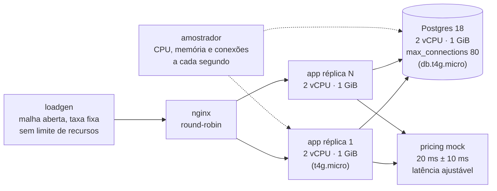

# Benchmarks: Go, Java e Python no tamanho de instâncias AWS

[English](BENCHMARKS.md) | **Português**

Mesmo serviço, mesma especificação, mesmos testes de contrato, mesmos limites de CPU e memória das instâncias t4g da AWS. O que muda é a linguagem e, no caso do Go, se o agente que escreveu o código tinha as go-skills carregadas.

Medido em outubro de 2026, em Docker Desktop, com limites de container que reproduzem o tamanho das instâncias AWS. Nenhum recurso foi criado na AWS; os custos usam os preços públicos on-demand da AWS daquele mês. **Cada cenário rodou 3 vezes**; os números são a mediana, com a faixa mínima–máxima entre parênteses onde ela importa.

## Resumo

| | Go com go-skills | Go sem go-skills | Java 25 + Spring Boot | Python 3.13 + FastAPI |
|---|---|---|---|---|
| Capacidade por réplica (2 vCPU, 1 GiB) dentro do SLO | **5.000 req/s** (3 de 3) | 5.000 req/s (3 de 3) | 3.000 req/s (4.000 em 1 de 3), JVM aquecida | 1.200 req/s (3 de 3) |
| CPU por requisição a 1.200 req/s | **0,35 ms** | 0,36 ms | 0,52 ms | 0,92 ms |
| Memória em carga normal | **15 MiB** | 16 MiB | 275 MiB | 206 MiB |
| Pico de memória (pior cenário) | **35 MiB** | 572 MiB | 928 MiB de 1.024 | 211 MiB |
| Acima da capacidade | **recusa com 503, p99 ~130 ms, segue no ar** | p99 de 1,7 s, depois 66% de erros | 90%+ de erros | 16–58% de erros |
| Começando a frio em 3.000 req/s | **0% de erros** | 0% de erros | 92% de erros | — |
| US$/mês para 5.000 req/s (us-east-1) | **45** | — | 68 | 137 |
| US$/mês para 20.000 req/s (us-east-1) | **180** | — | 270 | 547 |

SLO: p99 abaixo de 200 ms e menos de 1% de erros.

### Go otimizado: o dobro da capacidade

Uma quarta versão em Go, [go-tuned](benchmarks/orders-api/impl/go-tuned/), parte da versão com go-skills e aplica duas mudanças guiadas por perfil de CPU, com as mesmas regras de justiça (mesmo contrato, no máximo 8 conexões por réplica, nenhum cache de preços ou de leituras). O [TUNING.md](benchmarks/orders-api/impl/go-tuned/TUNING.md) mostra cada mudança e o efeito medido.

1. **Uma ida ao banco por leitura.** Pedido e itens vêm na mesma query (`LEFT JOIN LATERAL` com `array_agg`), em vez de uma query para os pedidos e outra para os itens.
2. **Cliente de preços dimensionado e com circuit breaker.** O limite de chamadas simultâneas ao serviço de preços era 64 com espera de 100 ms, e esse número chutado era a única causa dos 503 a 6.000 req/s. Agora é 256, calculado pela lei de Little e sem espera; cada chamada tem orçamento de 1 s; e um circuit breaker abre depois de 5 falhas seguidas.

Verificado à parte, 3 rodadas:

| | Go com go-skills | **Go otimizado** |
|---|---|---|
| Capacidade dentro do SLO | 5.000 · 5.000 · 5.000 | **10.000 · 8.000 · 10.000** |
| 6.000 req/s | 1,3% de erros, p99 130 ms | **0%, p99 32 ms** |
| 8.000 req/s | 4,8% de erros, p99 132 ms | **0%, p99 32 ms** |
| 10.000 req/s | 17% de erros, p99 143 ms | **0,65% de erros, p99 47 ms** |
| 12.000 / 14.000 req/s | — | 18% / 39% de 503 rápidos, p99 ~60 ms |
| CPU por requisição a 3.000 req/s | 0,305 ms | **0,277 ms** (−9%) |
| p99 com o serviço de preços em 1,5 s | 1.594 ms | **3 ms** |
| Pico de memória | 35 MiB | 54 MiB |

Uma ressalva: no cenário de 8 réplicas (S2), uma das 5 rodadas do Go otimizado teve uma lentidão do banco que encheu os pools (65 conexões) e gerou 0,5% de erros; as outras 4 ficaram limpas, e a versão com go-skills ficou limpa nas 5. Pela leitura dos logs, foi o banco que ficou lento para todas as operações ao mesmo tempo, não o serviço; o registro fica aqui porque aconteceu.

**Leitura honesta:** Java aquecido entrega 60% da capacidade do Go por réplica, com 18 vezes mais memória, precisa aquecer antes de aguentar carga, e desaba quando passa do limite. Python custa 2,6 vezes mais CPU por requisição. A maior diferença do Go não está na média, e sim no comportamento sob pressão: memória plana, nenhum aquecimento, e degradação controlada quando a carga passa da capacidade.

---

## Mapa dos testes



| Cenário | Carga | O que mede |
|---|---|---|
| **S1 capacidade** | rampa 200 → 3.000 req/s, 20 s por degrau, 1 réplica | maior taxa dentro do SLO, CPU por requisição |
| **S2 frota** | 2.000 req/s por 60 s, 8 réplicas | se a soma dos pools cabe nas 80 conexões do banco |
| **S3 pico** | 800 → 4.000 → 800 req/s | se o serviço sobrevive a um pico e se recupera |
| **S4 dependência lenta** | 400 req/s com o serviço de preços em 1,5 s | se o resto da API continua respondendo |
| **S5 limite a frio** | rampa 3.000 → 10.000 req/s, sem aquecimento | onde cada implementação quebra e como quebra |
| **S7 Java aquecido** | rampa 500 → 8.000 req/s, 90 s de aquecimento | capacidade justa da JVM depois do JIT |

Cada cenário rodou 3 vezes, sempre com o banco recriado e populado (200.000 pedidos, 600.000 itens, um cliente com 40.000 pedidos) e com os testes de contrato antes da carga. Implementação que não passa no contrato não é medida; as quatro passaram em todas as 60 execuções.

### Carga de trabalho

| Operação | Fração | O que exercita |
|---|---|---|
| `GET /orders/{id}` | 45% | leitura por chave com itens |
| `GET /customers/{id}/orders` | 25% | paginação com itens (armadilha de N+1 e OFFSET); 10% no cliente com 40 mil pedidos |
| `POST /orders` | 15% | transação com 3 itens |
| `GET /orders/{id}/quote` | 15% | fan-out para o serviço de preços, um GET por item |

O gerador agenda cada requisição num relógio fixo e mede a latência a partir do horário agendado. Um servidor que trava paga pela fila que cria; requisição acima de 2 s conta como erro.

---

## Modelos

### As quatro implementações

Todas foram geradas por um agente de código a partir da mesma [especificação](benchmarks/orders-api/SPEC.md), sem edição manual, e passaram nos mesmos [testes de contrato](benchmarks/orders-api/harness/contract/contract_test.go).

| Implementação | Stack | Escolhas do próprio código |
|---|---|---|
| [Go com go-skills](benchmarks/orders-api/impl/go-with/) | Go 1.26, `net/http`, pgx v5 `pgxpool` | pool = 80 conexões ÷ 10 réplicas, espera de 250 ms pelo pool e 503, paginação keyset, `= ANY` para itens |
| [Go sem go-skills](benchmarks/orders-api/impl/go-without/) | Go 1.26, `net/http`, pgx v5 `pgxpool` | pool de 8, timeout de 3 s por query, paginação keyset, `= ANY` para itens |
| [Java](benchmarks/orders-api/impl/java/) | Java 25, Spring Boot 3, Spring MVC com virtual threads, JDBC + HikariCP | `-XX:MaxRAMPercentage=70`, `ExitOnOutOfMemoryError` |
| [Python](benchmarks/orders-api/impl/python/) | Python 3.13, FastAPI, uvicorn (2 workers, uvloop), asyncpg | um pool por worker |

As versões Java e Python trouxeram o próprio Dockerfile, mantido como veio. As duas versões Go usam o mesmo [Dockerfile](benchmarks/orders-api/harness/go.Dockerfile) (build estático, distroless).

### Instâncias reproduzidas

| Papel | Limite no container | Equivalente AWS |
|---|---|---|
| Aplicação | 2 vCPU, 1 GiB | EC2 t4g.micro |
| Banco | 2 vCPU, 1 GiB, `max_connections=80`, `shared_buffers=256MB` | RDS db.t4g.micro |
| Load balancer, gerador e mock | sem limite | fora da conta |

### Modelo de custo

- Preços on-demand Linux da AWS, outubro de 2026, tirados dos arquivos públicos de preço.
- T4g roda em modo **unlimited** por padrão: preço por hora + US$ 0,04 por vCPU-hora de CPU média acima da base (t4g.micro 10% × 2 vCPU = 0,2 núcleo; small e medium 20% × 2 = 0,4).
- Cada instância é planejada a 70% da capacidade mediana (30% de folga) e cada frota tem no mínimo 2 instâncias.
- 730 horas por mês. O banco fica fora da conta porque as queries são as mesmas em todas as implementações.

| Instância | vCPU | Memória | us-east-1 (US$/h) | sa-east-1 (US$/h) |
|---|---|---|---|---|
| t4g.micro | 2 | 1 GiB | 0,0084 | 0,0134 |
| t4g.small | 2 | 2 GiB | 0,0168 | 0,0268 |
| t4g.medium | 2 | 4 GiB | 0,0336 | 0,0536 |
| db.t4g.micro (RDS PostgreSQL) | 2 | 1 GiB | 0,016 | 0,034 |

---

## Resultados

### Capacidade e eficiência (S1, S5, S7)

| | Capacidade em cada rodada | p99 na capacidade | CPU por requisição a 1.200 req/s | CPU por requisição a 3.000 req/s | Memória |
|---|---|---|---|---|---|
| Go com go-skills | 5.000 · 5.000 · 5.000 | 43 ms (39–43) | 0,352 ms (0,301–0,370) | 0,305 ms (0,244–0,319) | 15 MiB |
| Go sem go-skills | 5.000 · 5.000 · 5.000 | 41 ms (40–45) | 0,355 ms (0,352–0,373) | 0,314 ms (0,311–0,405) | 16 MiB |
| Java (aquecido) | 4.000 · 3.000 · 3.000 | 33 ms a 3.000 | 0,520 ms (0,515–0,563) | 0,453 ms (0,433–0,474) | 275 MiB (233–284) |
| Python | 1.200 · 1.200 · 1.200 | 77 ms (77–87) | 0,924 ms (0,907–1,069) | — | 206 MiB |

O p99 em torno de 32 ms em carga normal é a operação de cotação, que espera os 20 ms do serviço de preços.

### Acima da capacidade (S5, S7)

Taxa de erros, mediana das 3 rodadas:

| Taxa | Go com go-skills | Go sem go-skills | Java (aquecido) | Python |
|---|---|---|---|---|
| 1.600 req/s | 0% | 0% | 0% | 15,9% |
| 4.000 req/s | 0% | 0% | 0% em 2 rodadas, 70% em 1 | — |
| 5.000 req/s | 0%, p99 43 ms | 0%, p99 41 ms | **90%**, p99 12 s | — |
| 6.000 req/s | 1,3% (503 rápido), p99 130 ms | 0%, mas **p99 1,7 s** | 90% | — |
| 8.000 req/s | 4,8% (503 rápido), p99 132 ms | **65,6%**, p99 16 s | 97% | — |
| 10.000 req/s | 17% (503 rápido), p99 143 ms | 99,6% | — | — |
| Memória no pior momento | **35 MiB** | 572 MiB (550–593) | 922 MiB (916–929) | 211 MiB |

O Go com go-skills espera no máximo 250 ms por uma conexão do banco e responde 503 quando o pool esgota, como manda a skill `postgres-pgx-pool`. Por isso a latência fica abaixo de 150 ms mesmo com o dobro da capacidade: ele recusa o excesso em vez de enfileirar. A versão sem a skill espera até 3 s por conexão, a fila cresce, a memória chega a 572 MiB e o serviço desaba. O resultado se repetiu nas 3 rodadas.

### Pico e recuperação (S3: 800 → 4.000 → 800 req/s)

| | Erros durante o pico | Erros depois do pico | Memória |
|---|---|---|---|
| Go com go-skills | 0% | 0% | 25 MiB |
| Go sem go-skills | 0% | 0% | 20 MiB |
| Java | 94% (91–94), p99 27 s | **37%** (18–66), não se recuperou | 908 MiB |
| Python | 94% (94–95), p99 28 s | **27%** (5–33) | 211 MiB |

Neste cenário o Java teve 20 s de aquecimento a 800 req/s antes do pico. Em produção, é o que acontece quando o autoscaling sobe uma instância nova no meio de um pico.

### Começando a frio (S5: 3.000 req/s direto, sem rampa)

| | Erros nos primeiros 20 s |
|---|---|
| Go com go-skills | 0% |
| Go sem go-skills | 0% |
| Java | **92%** (90–93), e não se recuperou nos degraus seguintes |

### Frota de 8 réplicas (S2: 2.000 req/s)

| | Pico de conexões no Postgres | p99 | CPU total da frota |
|---|---|---|---|
| Go com go-skills | **20 / 80** (18–21) | 32 ms | 0,93 núcleo |
| Go sem go-skills | 26 / 80 (23–30) | 32 ms | 0,93 núcleo |
| Java | 65 / 80 | 61 ms (47–66) | 4,27 núcleos |
| Python | 65 / 80 | 223 ms (219–269) | 3,65 núcleos |

Com 250 req/s por réplica, Java e Python gastam cerca de 4 vezes mais CPU que o Go, porque o custo fixo de cada processo (JIT, GC, workers) se repete em todas as réplicas. Java e Python também chegaram a 65 das 80 conexões: com mais 2 réplicas num deploy, passariam do limite.

### Dependência lenta (S4: serviço de preços em 1,5 s)

Os cerca de 15% de erros esperados são as cotações, que devem falhar com 503 quando o serviço de preços demora. O que muda é como falham:

| | Como as cotações falham | p99 | Memória |
|---|---|---|---|
| Go com go-skills | 503 em 1,6 s | 1.594 ms | 15 MiB |
| Go sem go-skills | presas até o cliente desistir (2 s) | 2.002 ms | 22 MiB |
| Java | maioria presa até 2 s, parte com 503 | 2.002 ms | 421 MiB |
| Python | 503 em 1 s | 1.009 ms | 128 MiB |

As outras operações continuaram rápidas em todas as implementações (p50 abaixo de 2 ms).

---

## EC2: quantas instâncias e quanto custa

Melhor instância para cada linguagem, já respeitando a memória (o pico do Java, 928 MiB, não cabe com segurança em 1 GiB):

| Carga | Go com go-skills | Java 25 + Spring Boot | Python 3.13 + FastAPI |
|---|---|---|---|
| **1.000 req/s** | 2 × t4g.micro · **US$ 12** (SP: US$ 20) | 2 × t4g.small · US$ 25 (SP: US$ 39) | 2 × t4g.micro · US$ 28 (SP: US$ 35) |
| **5.000 req/s** | 2 × t4g.micro · **US$ 45** (SP: US$ 52) | 3 × t4g.small · US$ 68 (SP: US$ 90) | 6 × t4g.micro · US$ 137 (SP: US$ 159) |
| **20.000 req/s** | 6 × t4g.micro · **US$ 180** (SP: US$ 202) | 10 × t4g.small · US$ 270 (SP: US$ 343) | 24 × t4g.micro · US$ 547 (SP: US$ 634) |

Valores em US$ por mês em us-east-1; "SP" é a região de São Paulo (sa-east-1). Só a camada de aplicação; o RDS é o mesmo para todos.

**Economia do Go:** de 33% a 50% contra Java e de 56% a 67% contra Python, conforme a carga.

**Com o Go otimizado:** 2 × t4g.micro a 1.000 e 5.000 req/s (US$ 12 e US$ 41) e **3 × t4g.micro a 20.000 req/s (US$ 163, SP: US$ 174)**, contra 10 t4g.small do Java e 24 t4g.micro do Python. Metade das instâncias da versão com go-skills custa só 10% menos porque, no modo unlimited, 3 instâncias perto do limite pagam excedente de CPU; numa família sem créditos (c7g, m7g) a diferença seria maior. A conta usa a CPU por requisição medida a 3.000 req/s, que é conservadora: a 10.000 req/s o Go otimizado gastou 0,18 ms por requisição.

### Tabela completa

| Carga | Implementação | Instância | Cabe na memória | Instâncias | CPU por instância | US$/mês us-east-1 | US$/mês sa-east-1 |
|---|---|---|---|---|---|---|---|
| 1.000 req/s | Go com go-skills | t4g.micro | sim | 2 | 0,15 núcleo | 12,26 | 19,56 |
| 1.000 req/s | Go com go-skills | t4g.small | sim | 2 | 0,15 núcleo | 24,53 | 39,13 |
| 1.000 req/s | Go com go-skills | t4g.medium | sim | 2 | 0,15 núcleo | 49,06 | 78,26 |
| 1.000 req/s | Java | t4g.micro | **não** (pico 949 MiB) | 2 | 0,23 núcleo | 13,81 | 21,11 |
| 1.000 req/s | Java | t4g.small | sim | 2 | 0,23 núcleo | 24,53 | 39,13 |
| 1.000 req/s | Java | t4g.medium | sim | 2 | 0,23 núcleo | 49,06 | 78,26 |
| 1.000 req/s | Python | t4g.micro | sim | 2 | 0,46 núcleo | 27,56 | 34,86 |
| 1.000 req/s | Python | t4g.small | sim | 2 | 0,46 núcleo | 28,15 | 42,75 |
| 1.000 req/s | Python | t4g.medium | sim | 2 | 0,46 núcleo | 52,68 | 81,88 |
| 5.000 req/s | Go com go-skills | t4g.micro | sim | 2 | 0,76 núcleo | 45,11 | 52,41 |
| 5.000 req/s | Go com go-skills | t4g.small | sim | 2 | 0,76 núcleo | 45,70 | 60,30 |
| 5.000 req/s | Go com go-skills | t4g.medium | sim | 2 | 0,76 núcleo | 70,23 | 99,43 |
| 5.000 req/s | Java | t4g.micro | **não** (pico 949 MiB) | 3 | 0,76 núcleo | 67,01 | 77,96 |
| 5.000 req/s | Java | t4g.small | sim | 3 | 0,76 núcleo | 67,89 | 89,79 |
| 5.000 req/s | Java | t4g.medium | sim | 3 | 0,76 núcleo | 104,68 | 148,48 |
| 5.000 req/s | Python | t4g.micro | sim | 6 | 0,77 núcleo | 136,66 | 158,56 |
| 5.000 req/s | Python | t4g.small | sim | 6 | 0,77 núcleo | 138,41 | 182,21 |
| 5.000 req/s | Python | t4g.medium | sim | 6 | 0,77 núcleo | 211,99 | 299,59 |
| 20.000 req/s | Go com go-skills | t4g.micro | sim | 6 | 1,02 núcleo | 179,87 | 201,77 |
| 20.000 req/s | Go com go-skills | t4g.small | sim | 6 | 1,02 núcleo | 181,62 | 225,42 |
| 20.000 req/s | Go com go-skills | t4g.medium | sim | 6 | 1,02 núcleo | 255,21 | 342,81 |
| 20.000 req/s | Java | t4g.micro | **não** (pico 949 MiB) | 10 | 0,91 núcleo | 267,47 | 303,97 |
| 20.000 req/s | Java | t4g.small | sim | 10 | 0,91 núcleo | 270,39 | 343,39 |
| 20.000 req/s | Java | t4g.medium | sim | 10 | 0,91 núcleo | 393,03 | 539,03 |
| 20.000 req/s | Python | t4g.micro | sim | 24 | 0,77 núcleo | 546,62 | 634,22 |
| 20.000 req/s | Python | t4g.small | sim | 24 | 0,77 núcleo | 553,63 | 728,83 |
| 20.000 req/s | Python | t4g.medium | sim | 24 | 0,77 núcleo | 847,97 | 1.198,37 |

Gerada por [`harness/sizing`](benchmarks/orders-api/harness/sizing/main.go) a partir das medianas acima: capacidade de 5.000, 3.000 e 1.200 req/s e CPU de 0,305, 0,453 e 0,924 ms por requisição.

---

## Go com go-skills contra Go sem go-skills

Na carga normal, empate: o agente já escreve um Go bom sem as skills (pool de tamanho razoável, keyset, timeouts). A diferença aparece quando algo dá errado, e se repetiu nas 3 rodadas:

| | Com go-skills | Sem go-skills |
|---|---|---|
| Acima da capacidade (8.000 req/s) | 4,8% de erros, 503 rápido, p99 132 ms | 65,6% de erros, p99 16 s |
| Memória no limite | 35 MiB | 572 MiB |
| Dependência lenta | 503 em 1,6 s | presas até 2 s |
| Conexões com 8 réplicas | 20 de 80 | 26 de 80 |

---

## O que este teste não prova

- **Não é Graviton.** O host é x86 (Docker Desktop, 24 núcleos). Os limites de CPU e memória são os da t4g, mas a performance absoluta num ARM real é diferente. A comparação entre implementações, no mesmo host e com os mesmos limites, é o que vale.
- **Créditos de CPU não são simulados.** A conta do modo unlimited usa a CPU média medida; numa t4g real, rajadas curtas acima da base consomem créditos acumulados antes de gerar cobrança.
- **Um host para tudo.** Gerador, load balancer, banco e aplicação dividem a mesma máquina. Até 5.000 req/s o banco e o gerador não foram o gargalo, mas acima disso parte da degradação pode vir do host.
- **Código gerado, não ajustado à mão.** Cada implementação é o que o agente entregou a partir da especificação. Um time especialista ajustando GC, pool e workers pode melhorar Java e Python; o mesmo vale para Go.
- **Java a frio e aquecido.** Medimos os dois. A capacidade de 3.000 req/s é da JVM aquecida; a frio, a mesma JVM desaba a 3.000.
- **Sem TLS, sem autenticação, sem logs pesados.** O serviço é pequeno de propósito.

---

## Como reproduzir

Requisitos: Docker Desktop (ou Docker em Linux) e Go 1.26+.

```bash
cd benchmarks/orders-api/harness

# uma rodada completa de todos os cenários (cerca de 75 minutos)
bash reps.sh r1

# agregação com mediana e faixa, e dimensionamento
(cd analyze && go run . ../results)
(cd sizing && go run .)
```

Cada execução sobe a stack do zero, roda o contrato, aplica a carga, salva `load.jsonl`, `stats.csv`, `contract.txt` e `app.log` em `results/<cenário>-<implementação>-<rodada>/` e derruba tudo no fim. As tabelas agregadas desta medição estão em [`aggregate.md`](benchmarks/orders-api/harness/aggregate.md) e [`sizing.md`](benchmarks/orders-api/harness/sizing.md).
